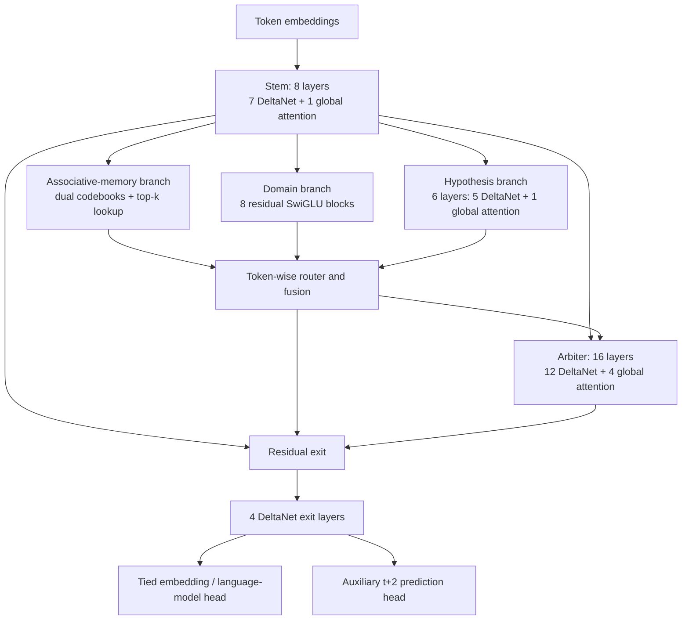

# Hetman-2b

Hetman is an experimental language-model research project. The repository contains model code and a small data/training pipeline; **it does not contain a pretrained, quality-validated assistant**.

## Current status

- A PyTorch model prototype combines recurrent DeltaNet layers, global attention, an associative-memory module, and an auxiliary multi-token prediction head.
- The model has dense floating-point trainable tensors. Ternary quantization is currently a fake-quantization experiment; packed low-bit weights and optimized kernels are not implemented.
- A single-node PyTorch trainer supports chunked training, validation, checkpoints, and resume. It has only passed small synthetic CPU checks. No full-corpus or target-GPU training run has been completed.
- The A/B/C pilot runner compares data recipes with a small GRU proxy. It does **not** train the Hetman model.
- A generation script can load a trainer checkpoint, but end-to-end generation and answer quality have not been validated.
- The companion [Rada.cpp](https://github.com/YaroslavSamchuk/Rada.cpp) project is an early container/runtime prototype and currently does not run model inference.

Context length, throughput, memory use, factuality, and safety are unverified. No benchmark result or absence of hallucinations is claimed.

## Architecture and research hypotheses

Hetman explores whether a small language model can benefit from combining recurrent sequence processing, periodic global attention, and an explicit associative-memory branch. This is a **design hypothesis**, not a demonstrated quality or efficiency improvement.



| Component | What the prototype does | What remains unproven |
| --- | --- | --- |
| **Hybrid sequence stack** | Configures 28 recurrent Gated DeltaNet layers and 6 global-attention layers. Global attention uses 12 query heads and 2 key/value heads. | Long-context memory use, throughput, and quality have not been measured. The configured 262,144-token context is not validated end to end. |
| **Three-branch processing** | From the stem representation, computes associative-memory, feed-forward, and hypothesis-processing branches. A token-wise softmax router weights them before fusion. | The branch roles and router have not been shown to improve factual recall, reasoning, or generalization. |
| **Associative-memory lookup** | Uses 16 groups and two codebooks per group, selecting top-8 and top-4 code entries. A commitment term and non-gradient routing-bias updates are included in the prototype. | The large value tensor is stored as dense floating-point parameters. Sparse lookup does not currently mean sparse or compressed storage; retrieval quality and routing stability need real training. |
| **Ternary/FWHT experiment** | Selected linear layers apply fake ternary weight quantization with a straight-through estimator; some inputs use a 512-wide blockwise Walsh–Hadamard transform. | Parameters remain dense floating-point tensors and operations use ordinary PyTorch linear algebra. There are no packed low-bit kernels or measured speed, memory, or accuracy gains. |
| **Multi-token prediction** | Adds an auxiliary head trained against the token at offset t+2. | It is an auxiliary training objective only; speculative decoding and faster generation are not implemented in the runtime. |
| **Data safeguards** | The pilot pipeline records source provenance, checks shard integrity, separates validation data, and blocks corpus creation until license review and held-out evaluation prompts are supplied. | Corpus rights have not yet been approved, the expected corpora/prompts are not present, and the current pilot's A/B/C comparison uses a GRU proxy rather than Hetman. |

The current configured model shape has about 2.16 billion parameters including the auxiliary head, based on a meta-device parameter count. This is a count of tensor elements—not a trained checkpoint, measured compute requirement, inference footprint, or evidence that the model fits a particular accelerator.

## Repository layout

| Path | Purpose |
| --- | --- |
| `src/modeling_hetman.py` and related modules | Experimental PyTorch model implementation |
| `src/train_hetman.py` | Single-node trainer for prepared shards |
| `src/build_pilot_datasets.py`, `src/train_pilot_tokenizer.py` | Data preparation and tokenizer-building pipeline |
| `src/run_pilot_experiment.py` | A/B/C data-recipe pilot using a GRU proxy |
| `src/generate_hetman.py` | Experimental checkpoint-based generation |
| `configs/pilot_dataset_recipes.json` | Pilot recipe and corpus-source configuration |
| `hf_package/` | Experimental Transformers-compatible code/config package; no trained weights |
| `scripts/` | Linux launchers for the pilot and single-node trainer |
| `tokenizer/` | Tokenizer files and tokenizer-training code |

## Development checks

The included checks exercise small numerical and data-pipeline cases. They do not demonstrate that the full model trains, fits a particular GPU, or gives useful answers.

```bash
python src/test_verification.py
python src/verify_all_blocks.py
```

The repository does not yet provide a pinned dependency lockfile. Install a compatible PyTorch build for the target machine; data preparation also uses packages such as `tokenizers` and, for Parquet inputs, `pyarrow`.

## Data and training gates

Raw corpora, processed shards, evaluation prompts, checkpoints, and logs are not included in Git. The configured corpus sources still require documented license/provenance review. Dataset building is designed to stop until the required reviews and a held-out benchmark-prompt file are supplied.

The single-node launcher expects validated train and validation shard bases (without `.bin` or `.idx`), a matching tokenizer, CUDA-enabled PyTorch, `tmux`, and `flock`:

```bash
export HETMAN_TRAIN_SHARD=/data/processed/train
export HETMAN_VAL_SHARD=/data/processed/validation
export HETMAN_TOKENIZER=/data/processed/tokenizer/tokenizer.json
export HETMAN_OUTPUT_DIR=/data/runs/hetman
bash scripts/launch_hetman_train.sh
```

Run a bounded hardware acceptance test before attempting a longer run. The launcher is not evidence that the model will fit, converge, or meet a particular schedule on a given node.

## License

There is currently no `LICENSE` file in this repository, so reuse and redistribution terms have not been declared. Do not treat the earlier Apache 2.0 badge or statements as a valid license grant. Select and add a license before making an open-source commitment or distributing the code or model artifacts.
