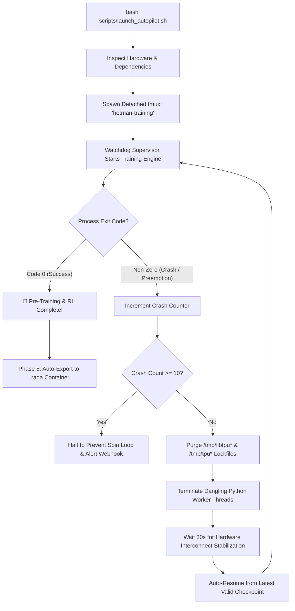

# Hetman-2.0B: Cloud TPU v5e-128 Autopilot Field Guide
### Battle-Tested Operational Manual for Unattended Multi-Week Distributed Pre-Training

[](#)
[](#)
[](#)
[](#)

---

## 🪖 Field Guide Philosophy: Why This Autopilot Exists

Anyone who has operated a distributed training cluster across 128 TPU accelerator chips over multiple weeks knows the harsh reality of large-scale deep learning: **hardware and cloud infrastructure fail when you least expect it**.

Google Borg spot preemptions trigger at 3:15 AM. Dormant network sockets in `/tmp/libtpu*` lock up driver handles. Transient optical interconnect glitches disconnect JAX worker nodes. An inadvertent laptop sleep kills your interactive SSH session, severing a multi-day run. Unmonitored checkpoints silently consume 500 GB of disk space, freezing your VM on Day 11.

The **Hetman-2.0B Autopilot System** was engineered from painful real-world field experience. It is not just a wrapper script; it is an **autonomous, fault-tolerant control plane**. 

You execute **one command**, close your terminal, and walk away. The autopilot supervises hardware health, automatically flushes corrupted lockfiles upon preemption, prunes checkpoints to maintain disk headroom, executes an 855-Billion-token 4-phase curriculum, and compiles the final model into an optimized `.rada` single-file container.

---

## 🛡️ The 3 Golden Rules of Unattended TPU Ops

1. **Rule #1: Never train in an interactive shell.**  
   Network drops, laptop sleeps, and SSH timeouts will send `SIGHUP` and kill your process. Always launch via `bash scripts/launch_autopilot.sh`, which wraps execution inside a resilient, detached `tmux` session managed by an independent watchdog.
2. **Rule #2: Never blindly `kill -9` a running TPU process.**  
   Abruptly killing JAX/XLA processes leaves `/tmp/libtpu*` hardware sockets in a dirty locked state that prevents subsequent initialization. Always use `bash scripts/stop_training.sh` to trigger a graceful shutdown and flush pending tensors to disk.
3. **Rule #3: Guard your disk storage aggressively.**  
   A full FP32/BF16 optimizer state with model weights is ~14 GB per checkpoint. Saving every 1,000 steps without pruning will exhaust a 500 GB boot disk in 48 hours. Our rolling manager maintains only the top-3 most recent checkpoints plus the best validation checkpoint per phase.

---

## ⚡ Quickstart: Launching in 60 Seconds

Once your Cloud TPU v5e-128 Pod Slice is provisioned:

```bash
# 1. SSH into the TPU VM host
ssh <user>@<tpu-vm-ip>

# 2. Enter project root directory
cd Hetman-2b

# 3. (Optional) Set up remote webhook alerts for Telegram, Discord, or Slack
export WEBHOOK_URL="https://discord.com/api/webhooks/..."

# 4. Fire the autonomous autopilot
bash scripts/launch_autopilot.sh
```

**That is all.** The launcher performs initial sanity checks, installs any missing JAX/Flax/TPU driver dependencies, spawns the persistent `tmux` session (`hetman-training`), and hands control to the watchdog supervisor.

You can safely disconnect your SSH session or shut down your local machine immediately.

---

## ⚙️ Under The Hood: The Watchdog & Recovery Loop

When `launch_autopilot.sh` executes, it builds and spawns `.watchdog_runner.sh` inside an isolated `tmux` environment. Here is how it guarantees multi-week survival:



### Self-Healing Mechanics
* **Crash Counter:** Differentiates between transient cloud preemptions and fatal configuration bugs. If 10 consecutive immediate crashes occur without forward step progress, the watchdog halts to prevent log flooding.
* **Socket Sanitization:** Google Cloud TPU runtime utilizes Unix domain sockets in `/tmp/libtpu*`. During a hard node reset, these remain locked. The watchdog executes `sudo rm -f /tmp/libtpu* /tmp/tpu*` before attempting any restart.
* **Atomic Orbax Checkpoint Recovery:** Checkpoints are written to `.tmp` staging directories before being atomically renamed. A preemption mid-write can never corrupt your last valid save state.

---

## 🗓️ The 5-Phase Curriculum Schedule (855 Billion Tokens, ~16.2 Days)

The autopilot automatically advances through all training phases without manual intervention:

| Phase | Duration | Token Volume | Context | LR Schedule | Objectives & Mathematical Formulations |
| :--- | :---: | :---: | :---: | :---: | :--- |
| **Phase 1: Base Pre-training** | ~14.2 days | 820 Billion | 4,096 | WSD Schedule<br>Peak: `1.8e-3`<br>Min: `1.8e-4` | Core language, code, logic, and factual recall. Global batch size: 4,194,304 tokens (1,024 seqs $\times$ 4k). MTP 2-token speculative auxiliary loss ($\lambda=0.3$). |
| **Phase 2: Long-Context Expansion** | ~1.9 days | 30 Billion | 262,144 | Stable Cosine<br>LR: `1.8e-4` | Context window extension to 256k tokens via YaRN RoPE ($s=64$) applied selectively to the 6 Global Attention layers. 28 DeltaNet layers retain $t=1.0$. |
| **Phase 3: Chat & Reasoning SFT** | ~8.4 hours | 5 Billion | 8,192 | Linear Decay<br>LR: `1.2e-4` | ChatML alignment, multi-turn reasoning traces `<think>...</think>`, and 2-sentence `<thought_summary>` compaction. |
| **Phase 4: In-Process Algorithmic RL** | ~4.0 hours | 500 steps | 8,192 | Constant<br>LR: `5.0e-5` | Alignment via Sum-Preserving GAR. Evaluates trajectories using in-memory Python AST verifier and statutory QA databases. |
| **Phase 5: Automated Binary Packaging** | ~2 minutes | Automatic | — | — | Automatic conversion of trained weights into packed 2-bit ternary format. Emits `hetman-2.0b-ternary.rada` ready for immediate `Rada.cpp` execution. |

---

## 📡 Real-Time Telemetry & Monitoring

You do not need to attach to the live console to know what the cluster is doing. The autopilot maintains multiple non-intrusive monitoring streams:

### 1. Terminal Dashboard (`bash scripts/status.sh`)
Execute at any time from your SSH shell:

```text
================================================================================
                   HETMAN-2.0B TPU AUTOPILOT TRAINING STATUS                    
================================================================================
 Timestamp:      2026-10-23 16:30:12 UTC
 Current Phase:  PHASE 1: 4K PRE-TRAINING
 Progress:       [████████████░░░░░░░░░░░░░░░░░░] 38.45% (Step 77,150 / 200,652)
 Tokens:         323,604,807,680 / 841,500,000,000 (38.45%)
 Current Loss:   1.8421
 Learning Rate:  1.800000e-03
 Throughput:     668,240 tokens/sec (26.5% Sustained MFU)
 Elapsed Time:   5 days, 11:23:14 (~5.47 days)
 Estimated ETA:  8 days, 18:41:02 (~8.78 days)
 System Status:  ACTIVE & HEALTHY (0 Errors, Checkpoints Rolling)
================================================================================
 [Process Status]: RUNNING (tmux session: hetman-training)
================================================================================
```

### 2. Live Log Streaming
```bash
# Follow live training logs and loss metrics
tail -f logs/training.log
```

### 3. Remote Webhook Alerts (Discord / Telegram / Slack)
If `WEBHOOK_URL` was exported prior to launch, the autopilot dispatches instant notifications for:
* 🚀 **Cluster Launch:** Initialized on TPU v5e-128 with device topology confirmation.
* 🔄 **Phase Transitions:** Advancing from Phase 1 to Phase 2 (YaRN expansion), etc.
* ⚠️ **Preemption Recovery:** Automatic lock clean-up and checkpoint reload alerts.
* 🎉 **Training Complete:** Final validation loss and confirmation of `.rada` export.

---

## 🧰 Command Field Reference

| Task | Command | Operational Notes |
| :--- | :--- | :--- |
| **Launch Autopilot** | `bash scripts/launch_autopilot.sh` | Idempotent. If already running, informs you without duplicating. |
| **Check Live Status** | `bash scripts/status.sh` | Formatted ASCII dashboard showing progress, loss, throughput, ETA. |
| **Read Raw Status** | `cat logs/STATUS.txt` | Single-shot plain text status view. |
| **Attach to Console** | `tmux attach -t hetman-training` | **Caution:** Disconnect safely using `Ctrl+B`, then `D`. |
| **Stream System Logs** | `tail -f logs/training.log` | Streams stdout/stderr from JAX/Flax training loops. |
| **Graceful Shutdown** | `bash scripts/stop_training.sh` | Sends `SIGINT`, waits up to 60s for checkpoint save, exits cleanly. |

> [!CAUTION]
> **When attaching to `tmux`:** Never press `Ctrl+C` while attached to the `hetman-training` session unless you intend to abort training!  
> To detach safely: Press **`Ctrl+B`**, release both keys, then press **`D`**.

---

## 🚨 Field Triage & Emergency Troubleshooting

### Triage 1: Host Machine Rebooted or Cloud TPU VM Restarted
If the cloud provider performed scheduled maintenance and rebooted the host VM:
1. SSH back into the machine: `ssh <user>@<tpu-vm-ip>`.
2. Navigate to root and run: `bash scripts/launch_autopilot.sh`.
3. The script inspects `checkpoints/latest_checkpoint.json`, verifies the last intact step, and seamlessly resumes training without losing more than a few minutes of progress.

### Triage 2: "TPU resource already in use / Socket locked"
If a previous process crashed uncleanly and JAX complains about unavailable devices:
```bash
# 1. Stop any dangling processes
pkill -9 -f "train_"

# 2. Clear Google libtpu domain sockets
sudo rm -f /tmp/libtpu* /tmp/tpu*

# 3. Relaunch autopilot
bash scripts/launch_autopilot.sh
```

### Triage 3: Inspecting TPU Device Connectivity in JAX
To verify that all 128 TPU v5e accelerator cores are visible to JAX:
```bash
python3 -c "import jax; print('Visible TPU Cores:', len(jax.devices())); assert len(jax.devices()) == 128"
```

---

## 🏁 Final Deliverable & Transition to Edge Inference

When Phase 4 completes, the autopilot triggers Phase 5 (`export_to_rada.py`). It:
1. Dequantizes FP32 master weights into exact $\{-1, 0, +1\}$ ternary trits.
2. Packs 16 ternary weights per `uint32_t` with row-wise alignment.
3. Computes FP32 per-channel dynamic scales $\gamma$ and CRC32 verification checksums.
4. Serializes the binary into `../rada.cpp/models/hetman-2.0b-ternary.rada`.

You will see the completion banner in `logs/TRAINING_COMPLETED.md`:
```text
================================================================================
 [✓] ALL TRAINING PHASES COMPLETED SUCCESSFULLY! 
================================================================================
[*] Phase 5: Automatically Exporting Trained Model to .rada Binary Container...
[✓] Successfully exported 897 tensors to ../rada.cpp/models/hetman-2.0b-ternary.rada
    Embedded Tokenizer: Present (65,536 vocab)
[🎉] Complete! Ready-to-use model produced at: ../rada.cpp/models/hetman-2.0b-ternary.rada
```

### Immediate Local Deployment:
Once copied to your edge device or laptop:
```bash
# High-throughput CLI inference (>350 tok/s on RTX 2060):
./rada.cpp/build/Release/rada_cli -m rada.cpp/models/hetman-2.0b-ternary.rada --style engineering

# Zero-dependency local Web UI:
./rada.cpp/build/Release/rada_web -m rada.cpp/models/hetman-2.0b-ternary.rada --port 8080
```
